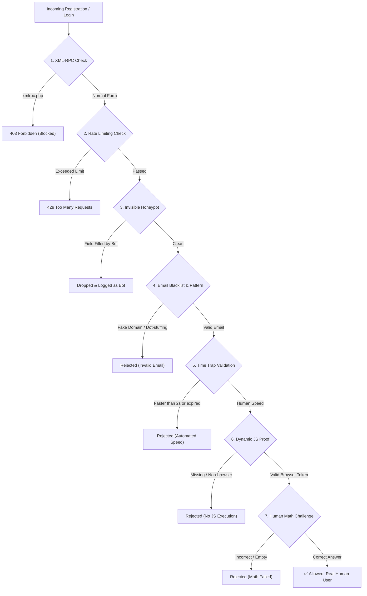

# HumanGuard (درع الحماية)

[](https://wordpress.org)
[](https://php.net)
[](LICENSE)
[](#features)
[](https://zohodigital.com)

**HumanGuard** is an advanced, production-grade anti-bot security plugin engineered for WordPress by [zohodigital.com](https://zohodigital.com). It eliminates automated bot registrations, brute-force credential stuffing, and XML-RPC exploits while maintaining a seamless, accessible user experience for legitimate humans.

Designed with native compatibility for **WordPress Core**, **Tutor LMS**, and **WooCommerce**, featuring a bilingual Arabic/English management dashboard.

---

## 🛡️ Multi-Layer Defense Architecture



### 1. Invisible Honeypot Trap
Dynamic decoy fields positioned far outside the viewport (`hg_user_website_hp`). Real human users never see or interact with these fields, but automated spam bots fill them automatically. Submissions containing values in honeypot fields are dropped instantly.

### 2. Form Submission Time Trap (Speed Limit)
Automated scripts submit forms within milliseconds. HumanGuard embeds an HMAC-signed timestamp token on render. Submissions completed in under 2 seconds or replayed after token expiration are rejected.

### 3. Dynamic JavaScript Browser Execution Proof
Automated tools like `curl`, Python `requests`, or scrapers lack interactive browser execution. HumanGuard executes a dynamic, lightweight client script that computes a challenge response token upon page interaction.

### 4. Interactive Human Math Verification
A clean, accessible math challenge (e.g., `3 + 5 = ?`) presented with Arabic & English labels. Operands are randomized and answer validation is verified server-side with HMAC cryptographic signing.

### 5. Disposable Email & Bot Pattern Blacklist
Instantly rejects known disposable/temporary email domains (`@example.*`, `@formtests.info`, `@mailinator.com`, `@tempmail.com`), as well as dot-stuffing patterns in email addresses used by botnets.

### 6. Brute Force Protection & Rate Limiting
- **Registration Limiting**: Caps registration attempts from the same IP to 3 attempts per 30 minutes.
- **Login Lockout**: Temporarily locks out IP addresses for 15 minutes after 5 consecutive failed login attempts.

### 7. XML-RPC Exploit Blocker
Blocks direct hits to `xmlrpc.php` and disables XML-RPC APIs, stopping pingback amplification and brute-force credential stuffing attacks.

---

## 🚀 Supported Platforms & Form Integrations

| Platform | Protected Endpoints / Hooks |
|---|---|
| **WordPress Core** | `/wp-login.php`, custom login URLs (`/login/` via WPS Hide Login), `register_form`, `registration_errors`, `authenticate`, `lostpassword_form` |
| **Tutor LMS** | Student registration (`/student-registration/`), Instructor registration (`/instructor-registration/`), AJAX endpoints (`tutor_action=tutor_register_student`) |
| **WooCommerce** | Customer registration form, checkout registration, login validation |

---

## 🖥️ WordPress Admin Dashboard

Under **WP Admin ➔ HumanGuard**:
- **نظرة عامة (Overview)**: Real-time security telemetry showing total neutralized threats, blocked bot registrations, brute-force lockouts, and blocked XML-RPC hits.
- **تنظيف الحسابات الوهمية (Bot Account Cleaner)**: Intelligent heuristic scanner that detects bot accounts and provides a 1-click safe bulk deletion tool (Administrators and Instructors are protected).
- **سجل الهجمات (Attack Logs)**: Live audit log showing IP addresses, timestamps, attack vectors, user agents, and block reasons.
- **الإعدادات (Settings)**: Toggle and fine-tune each security layer independently, or optionally integrate Cloudflare Turnstile.

---

## 📦 Installation

### Method 1: Manual Installation
1. Clone or download this repository:
   ```bash
   git clone https://github.com/mrsoutih-dev/wp-human-guard.git
   ```
2. Upload the `wp-human-guard` folder to your WordPress plugins directory:
   ```
   wp-content/plugins/wp-human-guard/
   ```
3. Activate the plugin via **WP Admin ➔ Plugins** or using WP-CLI:
   ```bash
   wp plugin activate wp-human-guard
   ```

### Method 2: Zip Archive
1. Compress the plugin folder into `wp-human-guard.zip`.
2. Go to **WP Admin ➔ Plugins ➔ Add New ➔ Upload Plugin**.
3. Choose the `.zip` file and click **Install Now**, then **Activate Plugin**.

---

## ⚙️ Configuration & Options

All features work out of the box with zero external configuration required. Default settings:
- **Honeypot Trap**: Enabled
- **Time Trap**: Enabled (Minimum 2 seconds)
- **JavaScript Browser Proof**: Enabled
- **Math Challenge**: Enabled for registration, dynamic for login
- **Email Blacklist**: Enabled
- **Rate Limiting**: Enabled
- **XML-RPC Blocking**: Enabled
- **Cloudflare Turnstile**: Optional (enter your Site Key & Secret Key in settings if desired)

---

## 📄 License

This project is licensed under the **GNU General Public License v2.0 or later** - see the [LICENSE](LICENSE) file for details.

---

## 👥 Builder & Founder

Designed and engineered with ❤️ by **[zohodigital.com](https://zohodigital.com)**.
